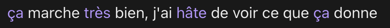
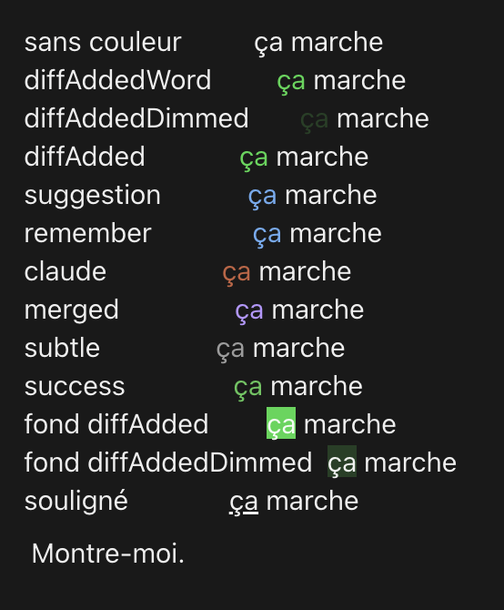

# correcteur



Ce qui a été tapé : `ca marche tres bien, j'ai hate de voir ce que ca donne`.

Affiche vos messages avec les fautes de français corrigées, chaque mot corrigé
repris dans une autre couleur. Le message d'origine n'est pas modifié : il reste
tel que vous l'avez tapé, et c'est cette version-là que le modèle lit pour
travailler. Seule la ligne affichée change.

## Ce qu'il corrige

Les mots mal orthographiés, les accents, les accords et la conjugaison, les
homophones (`a`/`à`, `ou`/`où`, `sais`/`c'est`) et les traits d'union
obligatoires. Rien d'autre : ni les majuscules, ni la ponctuation, ni le style,
ni l'ordre des mots, ni le vocabulaire.

**Ce correcteur ne corrige que le français**, et c'est délibéré. Un message
écrit dans une autre langue revient intact : vérifié sur de l'anglais fautif,
qui n'est ni traduit ni corrigé. Les anglicismes au milieu d'une phrase
française passent sans encombre.

Cette limite est aussi une protection, et c'est le cas qui l'a montré : dans
`traduis ca stp : the frames are delivered with the tpu kit`, seul `ca` est
corrigé. Le texte à traduire ressort tel quel. Rendre l'outil bilingue ferait
perdre exactement ça.

## Ce qu'il consomme

**Chaque message que vous tapez part dans un appel à Claude Haiku, sur votre
propre compte.** Il n'y a pas de clé à fournir : le mod emprunte le client de la
session, donc la dépense tombe sur votre abonnement ou sur votre facture d'API,
pas sur celle de quelqu'un d'autre.

L'ordre de grandeur, mesuré sur cinq mois de messages réels : environ 345 tokens
en entrée et 45 en sortie par message, soit à peu près **0,10 $ par mois pour
soixante messages par jour** aux tarifs de Haiku 5.5. À titre de comparaison,
c'est moins d'un demi pourcent de ce que coûte un seul tour de conversation avec
un modèle Opus sur un contexte déjà rempli.

C'est négligeable, mais c'est votre quota et vous avez le droit de le savoir
avant d'installer. `/correcteur off` arrête les appels, `/correcteur on` les
reprend, et le choix est gardé d'une session à l'autre.

Ne partent jamais : les messages de plus de 600 caractères, ceux qui commencent
par un signe, ceux qui contiennent un bloc de code, et tout ce qui ne vient pas
de vous.

## Ce qu'il refuse de faire

La correction vient d'un appel à Claude Haiku, et une consigne n'est pas une
garantie. Le message part encadré entre balises, avec interdiction d'obéir à ce
qu'il contient, et quatre verrous s'appliquent ensuite à la réponse, en local :

- un mot protégé touché annule toute la correction du message : un mot tout en
  majuscules, un mot contenant un chiffre, un chemin, une URL, ou un nom de la
  liste `PROTEGES` ;
- un mot perdu annule toute la correction, les traits d'union étant neutralisés
  dans le comptage pour ne pas confondre une soudure avec une disparition ;
- une différence qui ne tient qu'à la casse est annulée, pas affichée ;
- au-delà de trois mots changés et de 40 % du texte, ou de 15 % d'écart de
  longueur, c'est une réécriture et non une correction : elle est rejetée.

Ne partent jamais chez le correcteur : les messages de plus de 600 caractères,
les commandes commençant par `/`, `!` ou `#`, les blocs de code, les collages,
et tout message venant d'une notification ou d'une autre session.

Ce qu'aucun verrou n'attrape : un arbitrage de sens sur une terminaison ambiguë
(`pourré` rendu `pourras` au lieu de `pourrais`) produit du français correct.
C'est la raison pour laquelle le message d'origine n'est jamais réécrit.

## Commandes

- `/correcteur` — l'état et des compteurs par étage : rendus vus, origines,
  appels, réponses, corrigés, refusés, dessinés. C'est la sonde de diagnostic.
- `/correcteur on` et `/correcteur off`
- `/correcteur teinte <réglage>` — s'applique aussitôt, sans recharger

Taper **`teintes`** comme message dessine tous les réglages côte à côte dans le
rendu réel, pour choisir sur pièce.

## Vos propres mots protégés

La liste livrée ne contient que du vocabulaire technique et du jargon FPV. Les
mots qui comptent pour vous — noms de vos projets, de vos clients, de vos
produits, le vocabulaire de votre métier — sont à ajouter dans `PROTEGES`, en
haut de `hooks/register.tsx`, en minuscules. Un `/reload-plugins` suffit, sans
redémarrage.

Trois familles sont déjà couvertes par une règle et n'ont pas à y figurer : les
mots tout en majuscules (`ACME`), ceux qui contiennent un chiffre (`99.2%`,
`v2`), et tout ce qui ressemble à un chemin ou à une URL.

## Réglages



Taper `teintes` comme message dessine cette planche dans votre propre thème.

La surface du bureau ne rend pas fidèlement les couleurs libres : plusieurs hex
pâles différents donnent le même rendu éteint. Préférez donc les clés du thème,
qui suivent celui de la personne — `merged`, `subtle`, `diffAddedWord`,
`diffAddedDimmed`, `suggestion`, `claude`. Deux autres formes existent :
`souligne` laisse le mot à la couleur du texte et ne joue que sur un trait, et
`fond:<clé>` lui met un fond au lieu de le colorer.

Dans `hooks/register.tsx` : `TEINTE_DEFAUT`, `MAX_CAR` la longueur au-delà de
laquelle un message est laissé tranquille, `PART_MAX` le seuil de réécriture, et
`PROTEGES` la liste des mots intouchables.

## Installation

À l'invite d'une session en terminal :

```
/plugin install correcteur --marketplace zerpo-lab/correcteur
```

Dans l'app desktop, où `/plugin` ne s'exécute pas : le `+` à côté du champ de
saisie, puis Plugins, Add marketplace, puis Add plugin. Depuis un dossier local,
`claude plugin install correcteur --marketplace <chemin du dossier>` suffit, et
le mod reste alors relu depuis ce dossier à chaque `/reload-plugins`.

## Désinstaller

```
/plugin uninstall correcteur
```

Il ne laisse rien derrière lui sur le disque : ni fichier, ni dossier. Vos mots
protégés et vos réglages vivent dans le magasin du mod, que la désinstallation
emporte avec lui.

## Les tests

```
node --experimental-strip-types tests/logique.test.ts
```

Ils portent sur la logique de correction — l'alignement, les garde-fous, les
mots protégés, la normalisation de la casse — extraite de `hooks/register.tsx` à
l'exécution, de sorte que c'est le code livré qui est testé et jamais une copie.
